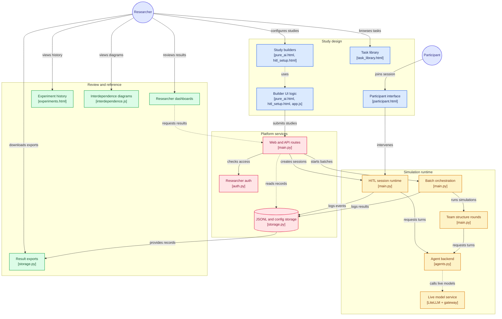

# Team Simulation Platform

FastAPI research platform for **organizational team studies** with AI-only teams and **human-in-the-loop (HITL)** sessions. Researchers configure study design in step-by-step builders, launch batch simulations or participant sessions, and review dashboards, transcripts, and exports.

## What you can do

### Pure AI batch studies (`/pure-ai`)

- Multi-step study builder: research design, task interdependence, task library or custom prompt, team composition, simulation settings, LLM configuration, review and launch
- Batch runs with configurable replications, concurrency, and optional random seed
- Live progress polling, stop, results dashboard, per-run viewer, CSV/JSON downloads
- Experiment history (browser local storage on builder pages; server listing via `/api/experiments`)

### Human + AI studies (`/hitl`)

- Same core design steps plus **human intervention rules** (participant role, message recipients, instructions)
- Participant intervention at the **end of each round** (fixed in the current UI)
- Participant link (`/participant/{session_id}`), researcher HITL dashboard, WebSocket-driven team flow with pause and targeted messaging

### Reference pages

| Route | Purpose |
| --- | --- |
| `/` | Overview and experiment history |
| `/task-library` | Research task catalog |
| `/research-capabilities` | Platform capabilities summary |
| `/interdependence` | Animated interdependence structure diagrams |

## Architecture

High-level flow from study design through simulation runtime to review. Diagram generated with [gitdiagram.com](https://gitdiagram.com); node labels map to this repository.



**Source files (quick links):** [templates](https://github.com/mughesh03/Team-Simulation-Platform/tree/main/app/templates) · [main.py](https://github.com/mughesh03/Team-Simulation-Platform/blob/main/app/main.py) · [agents.py](https://github.com/mughesh03/Team-Simulation-Platform/blob/main/app/agents.py) · [storage.py](https://github.com/mughesh03/Team-Simulation-Platform/blob/main/app/storage.py) · [interdependence.js](https://github.com/mughesh03/Team-Simulation-Platform/blob/main/app/static/interdependence.js)

## Task interdependence (backend)

Structures map to orchestration in `app/main.py`:

| UI label | Backend `team_structure` | Behavior (summary) |
| --- | --- | --- |
| Pooled | `pooled` | Independent member contributions, aggregated output |
| Sequential | `sequential` | Handoffs through a fixed pipeline |
| Reciprocal — Chain | `reciprocal_chain` | Bidirectional exchange with immediate neighbors |
| Team — Comprehensive | `reciprocal_comprehensive` | Full mutual adjustment within the team |

Legacy labels (`team`, `parallel`, `reciprocal`) may still appear in older configs or logs.

## Agent / LLM backend

`app/agents.py` implements:

- **Mock backend** — task-aware canned dialogue, timing suitable for local demos (no API key)
- **Live models** — via LiteLLM when a model is not `mock` and an API key is supplied (UI or env)

For **Kimi K2.5** (`kimi-k2.5`), set an OpenAI-compatible gateway:

1. Copy `app/llm_secrets.example.py` → `app/llm_secrets.py` (git-ignored)
2. Set `INSTITUTION_GENAI_API` and `KIMI_BASE_URL` (or use `.env` — see `.env.example`)

Public configs and exports **strip API keys**. Use **Mock Backend (Demo)** in the builder to run without credentials.

Core agent API (stable seam for extensions):

```python
await agent_turn(agent_name, turn_number, history, params)
await answer_human_question(agent_name, question, history, params)
```

## Run locally

Python 3.11+ recommended.

### Windows

```bash
python -m venv .venv
.venv\Scripts\activate
pip install -r requirements.txt
python run.py
```

### macOS / Linux

```bash
python3 -m venv .venv
source .venv/bin/activate
pip install -r requirements.txt
python run.py
```

Open **https://team-simulation-platform.onrender.com/**

Optional researcher login: set `RESEARCHER_PASSWORD` in `.env` (default documented in `.env.example`).

Mock runs work offline after dependencies are installed.

## Project layout

```text
app/
├── main.py              # Routes, batch orchestration, HITL sessions, WebSockets
├── agents.py            # Mock + live LLM turns
├── storage.py           # JSON/JSONL persistence, CSV export
├── llm_secrets.example.py
├── templates/           # Study builders, participant UI, dashboards
└── static/              # CSS, JS, interdependence visuals

data/
├── batches/             # Pure AI job configs + JSONL results
└── sessions/            # HITL session configs + JSONL events

run.py                   # Uvicorn entry (127.0.0.1:8000)
```

## Storage

Batch and session **configs** are JSON; **runtime events and turns** append to JSONL. Dashboards and downloads read from these files when present.

On **Vercel**, filesystem persistence is limited and background tasks do not survive after the HTTP response; Pure AI mock batches are designed to complete in-request. Long-running local servers use background tasks for progressive status updates. HITL WebSockets require a persistent host (local or a long-running VM), not serverless-only deploys.

## Human intervention event types (HITL JSONL)

```text
HUMAN_INFORMATION
HUMAN_TEAM_MESSAGE
HUMAN_QUERY
AGENT_REPLY_TO_HUMAN
PAUSE_REQUESTED
SESSION_PAUSED
RESUME
```

## Current limitations

- In-memory job/session registries: restarts lose in-progress work (JSONL on disk remains).
- WebSocket clients do not automatically replay full history on reconnect.
- Pause applies at round/safe boundaries; an in-flight LLM call is not cancelled mid-stream.
- Production hardening (auth beyond simple researcher password, consent flows, treatment randomization) is not complete.

## License / attribution

See repository settings on GitHub for license and contribution notes.
